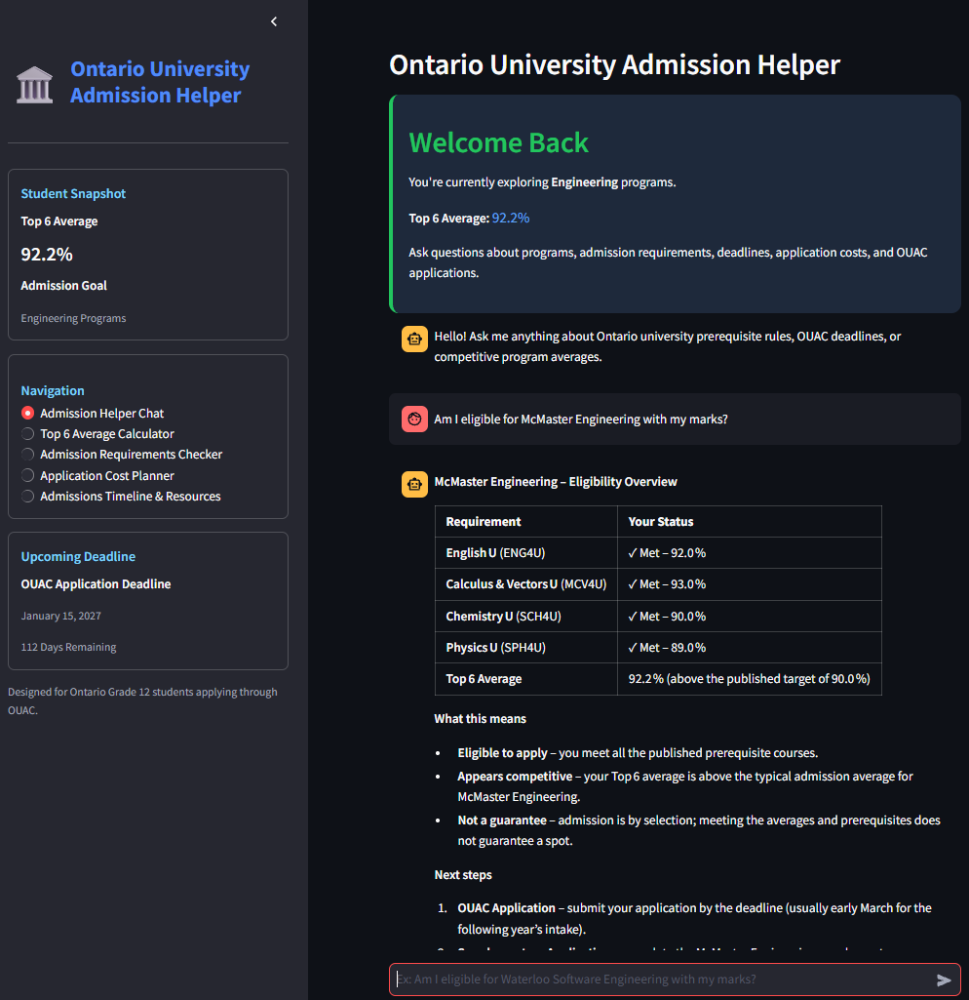
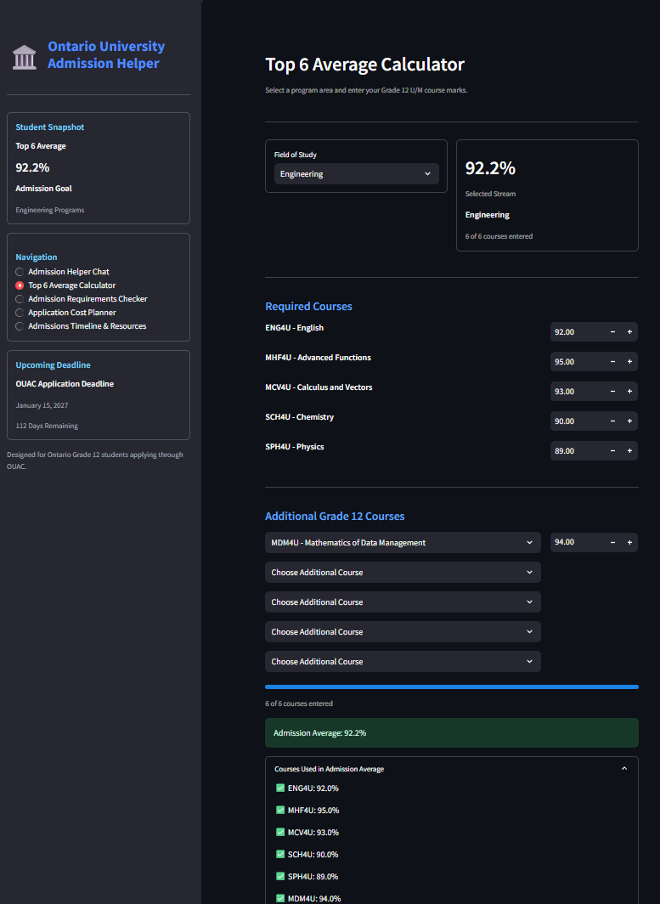
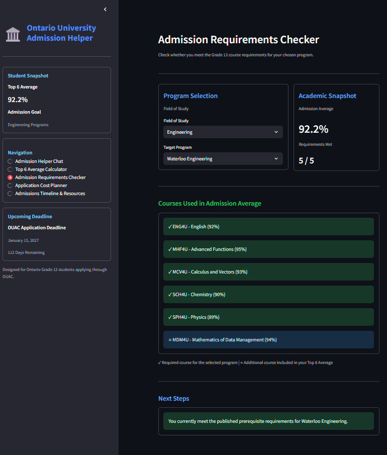
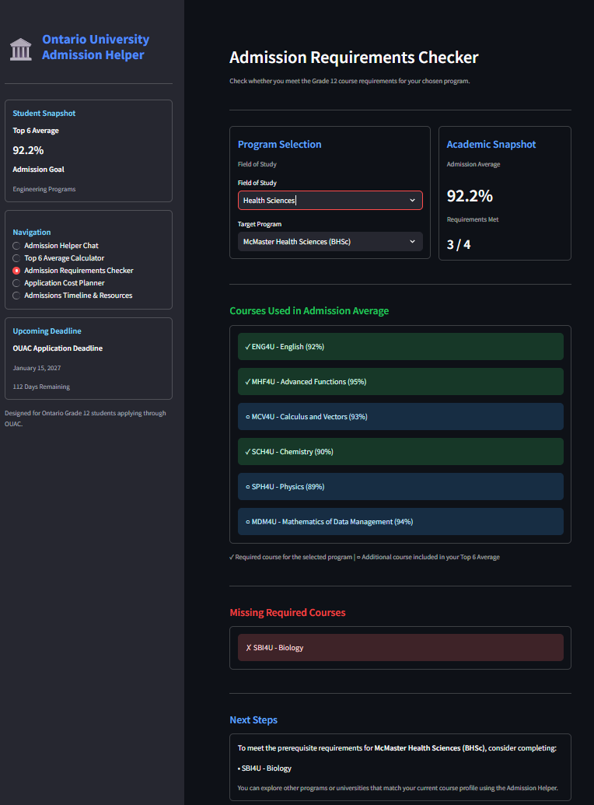
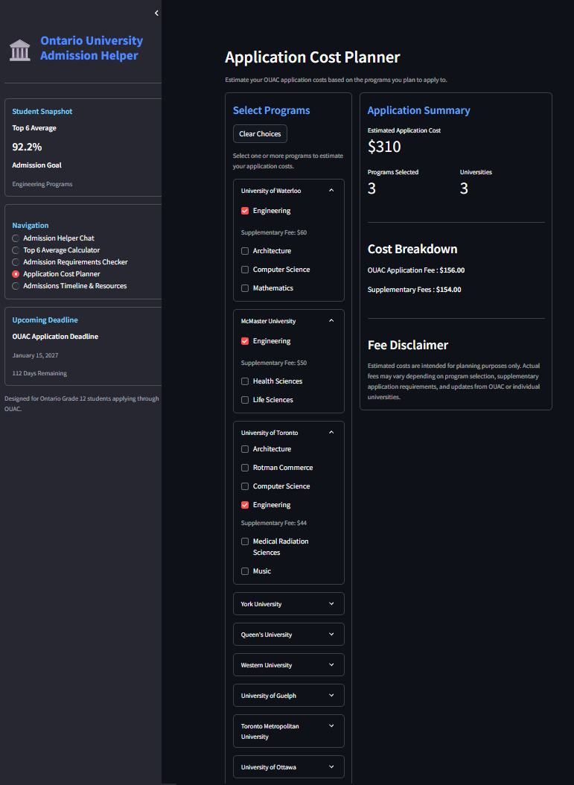
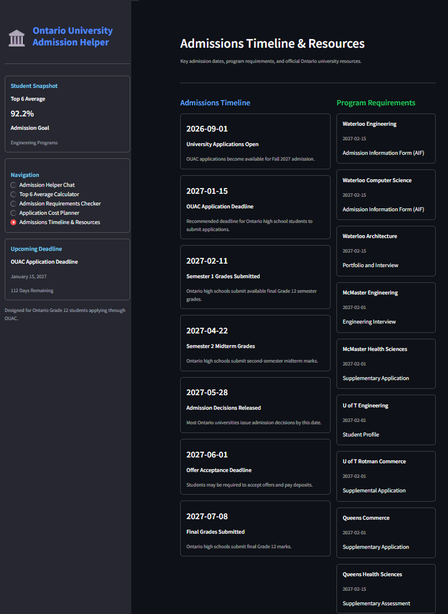

# Ontario University Admission Helper

 

**Created by Nandan Pappala**

 

## About the Project

 

Applying to university can be confusing. Students often need to visit multiple university websites to find admission requirements, deadlines, prerequisite courses, application costs, and program information.

I built Ontario Admission Assistant to make this process easier. It is an AI-powered platform that helps Ontario high school students explore university options, calculate admission averages, check prerequisites, track deadlines, estimate costs, and ask admission-related questions.

One of the main features is an AI Admission Assistant that uses a Retrieval-Augmented Generation (RAG) system to search official university and OUAC documents before generating answers.
 

The project includes several tools that help students:

 

- Calculate their Top 6 Average

- Check admission requirements

- Estimate application costs

- View important admission deadlines

- Explore Ontario university programs

- Ask admission-related questions using AI

 

The AI Admission Helper searches official admission resources before generating responses.

 

---

 

## Why I Built It

 

As a high school student, I noticed that many students spend a lot of time searching university websites to answer questions such as:

 

- What courses do I need?

- What average should I aim for?

- Am I missing any prerequisites?

- When are applications due?

- How much will applications cost?

 

I wanted to create a tool that could help students quickly find this information and better understand their options.

 

---

 

## Features

 

### Student Snapshot

 

Provides a quick overview of:

 

- Top 6 Average

- Admission Goal

- Upcoming Deadline

 


 

---

 

### Admission Helper Chat

 

Ask questions about:

 

- University programs

- Admission requirements

- OUAC applications

- Admission deadlines

- Supplementary applications



---

 

### Top 6 Average Calculator

 

Calculates Ontario university admission averages using Grade 12 U/M courses.

 

 



---

 

### Admission Requirements Checker

 

Checks program requirements and identifies missing prerequisite courses.

 




 


---

 

### Application Cost Planner

 

Estimates OUAC application fees and supplementary program costs.

 



 

---

 

### Admissions Timeline & Resources

 

Provides important admission dates and helpful university resources.

 
 

---

 

## Technology Used

 

- Python

- Streamlit

- LangChain

- LanceDB

- HuggingFace Embeddings

- GROQ

- Retrieval-Augmented Generation (RAG)

 

---

 

## How It Works

 

```text

University & OUAC Documents

            ↓

      Document Processing

            ↓

        Embeddings

            ↓

         LanceDB

            ↓

   Document Retrieval

            ↓

         GROQ AI

            ↓

      Student Response

```

 

---

 

## What I Learned

 

Through this project I learned about:

 

- Artificial Intelligence

- Retrieval-Augmented Generation (RAG)

- Prompt Engineering

- Vector Databases

- Document Processing

- Streamlit Development

- Problem Solving

 

One of the most interesting parts of the project was learning how an AI assistant can retrieve information from documents before generating an answer.

 

---

## Demo Video

 

_To Be Done._

 

---

 

## Disclaimer

 

This project was created as a Grade 12 passion project for learning purposes.

 

Students should always verify admission requirements, deadlines, fees, and application information through OUAC and official university websites before making application decisions.

 
